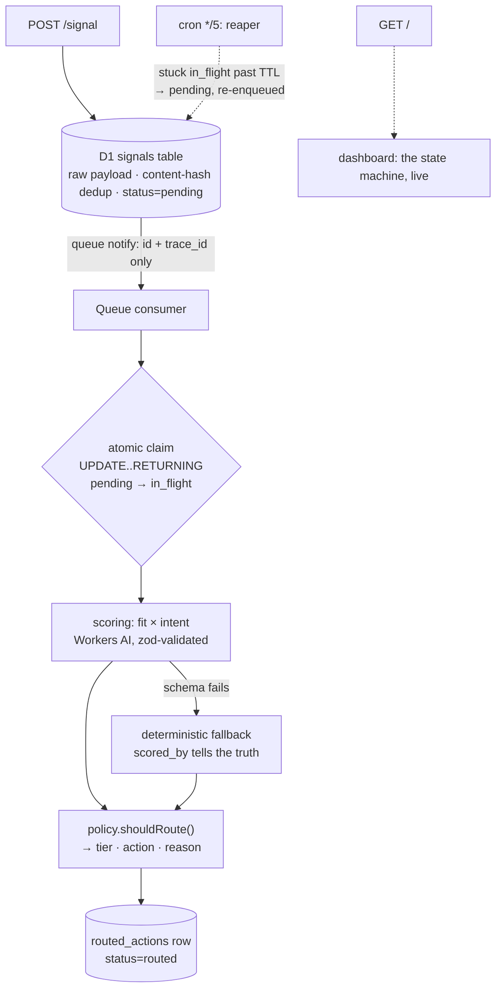

# gtm-signal-pipeline

A signal-driven GTM pipeline running entirely on Cloudflare primitives: **Workers + D1 + Queues + Workers AI + cron triggers.**

This is the production pattern I run for real GTM systems, miniaturized onto a single Worker so every architectural decision is inspectable. A signal comes in, lands in a durable inbox, gets claimed atomically, scored on two independent dimensions, and routed with a reason a rep could act on. Crashed workers get rescued by a reaper. A model having a bad day never kills a signal.

**Live demo:** `https://gtm-pipeline.shanefirek.com` (POST a signal, watch it walk the state machine)



## Try it

```bash
# a hot signal: enterprise headcount, senior title, pricing page, demo request
curl -X POST https://gtm-pipeline.shanefirek.com/signal \
  -H "content-type: application/json" \
  -d '{"source":"form_fill","company":"Acme","domain":"acme.com","title":"VP of IT","employee_count":900,"page":"/pricing","action":"demo_request"}'

# a junk signal: anonymous blog visit
curl -X POST https://gtm-pipeline.shanefirek.com/signal \
  -H "content-type: application/json" \
  -d '{"source":"website_visit","page":"/blog/some-post"}'

# inspect either by trace_id (returned in the POST response)
curl "https://gtm-pipeline.shanefirek.com/api/signal?trace_id=<trace_id>"
```

The first routes `hot / alert_rep`. The second routes `archive`. Both carry a reason that names exactly which components contributed.

## The patterns on display

Every pattern below exists because a production failure taught it to me. The third column is the point: a principle without enforcement is an aspiration, and aspirations lose to deadlines.

| Pattern | Why it exists | What enforces it here |
|---|---|---|
| **Inbox-first ingest** | If the queue hiccups after you ack a webhook, the signal is gone forever | `ingest.ts` persists the raw row BEFORE enqueueing. The queue message carries only `{id, trace_id}`. The database is the source of truth; the queue is a notifier. |
| **Content-hash dedup** | Webhook providers retry; double-ingest poisons everything downstream | `UNIQUE(content_hash)` constraint. Duplicate POST returns 409. |
| **Atomic claim** | Two consumers grabbing the same row double-fire enrichment and CRM writes | `UPDATE .. SET status='in_flight' WHERE id=? AND status='pending' RETURNING`. One winner, no locks, race-proof at the DB level. |
| **Reapers** | A worker that crashes mid-job strands its row in limbo forever | Cron sweep returns stale `in_flight` rows to `pending` and re-enqueues. `reap_count` records every rescue. |
| **Kill switches, three levels** | "Redeploy to stop the bleeding" is not an incident response | `PIPELINE_ENABLED` (global), `AI_SCORING_ENABLED` (per integration), `DRY_RUN` (score but write no actions). All config, no deploy. |
| **LLM as unreliable narrator** | Models return fenced JSON, prose preambles, and invented numbers | AI output is untrusted until it passes a zod schema with bounds. One feedback retry. Any failure falls back to deterministic scoring. The signal never dies because a model failed. |
| **Score provenance** | Six months later you need to know which brain scored a row | `scored_by` column records `deterministic`, `ai:<model>`, or `deterministic-fallback` on every signal, frozen at scoring time. |
| **Two-dimension scoring** | Fit alone is a list. Intent alone is noise. | `fit` (does the org look like a buyer) and `intent` (does the behavior look like buying) are scored independently. The hot tier requires both. |
| **Reasons, always** | "Blocked by gate" without naming the gate costs you hours at midnight | `policy.ts` returns `{ tier, action, reason }`. Routing without a reason is structurally impossible. |
| **Trace threading** | Debugging a pipeline without correlation IDs is archaeology | `trace_id` minted at ingest, threaded through queue, scoring, and routing. Every log line is structured JSON. |
| **Hostile-input posture** | An open ingest endpoint means every payload field is attacker-controlled, all the way to the pixels | Body size cap (413 past 8KB), source allowlist, and HTML escaping at render: payload strings reach the dashboard escaped, never raw. The smoke suite fires an actual XSS payload and asserts it lands inert. |
| **Smoke as the gate** | "It works" is not a claim that survives a deploy | `scripts/smoke.sh`: 18 mechanical assertions against a running instance. Exit 0 or it does not ship. |

## What is deliberately not here

The defer column is the architect's audit trail of saying no.

- **Auth**: the demo is the point; production puts signed webhooks on `/signal`
- **Real enrichment providers**: the seam exists (`scoring.ts`); waterfall providers plug in behind it
- **Real CRM writes**: `routed_actions` is where a Pipedrive/HubSpot/Salesforce adapter attaches
- **Durable Objects**: no per-entity coordination need at this scale; D1 atomic claims carry it
- **Multi-tenancy**: single-tenant demo; the `workspace_id` pattern adds one column and one index
- **Prompt registry / eval suite**: one prompt, no corpus yet; named so future-me knows it was a choice, not an oversight

## Run it locally

```bash
npm install
npm run db:local        # apply schema to local D1
npm run dev             # wrangler dev with local D1 + Queues + cron
npm run smoke           # 18 assertions, exit 0 = green
```

The AI path is off by default (`AI_SCORING_ENABLED=false`). Enable it with `wrangler dev --var AI_SCORING_ENABLED:true`. Force the fallback with `--var AI_MODEL:bogus` and watch `scored_by` tell the truth.

## Build log

Phased build with verifiable gates at each step: `docs/iteration-plan.md`. P0 was a walking skeleton with stub scoring; every phase after replaced exactly one stub with one real thing.

---

Shane Firek · [shanefirek.com](https://shanefirek.com) · [github.com/shanefirek](https://github.com/shanefirek) · [mcp-handbook.com](https://mcp-handbook.com)
